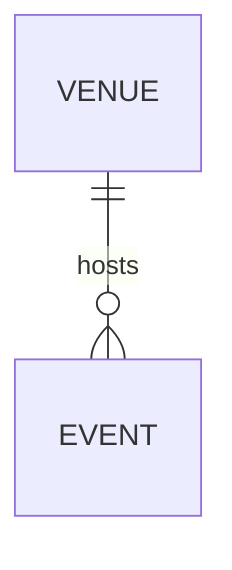

# Data Model

## Diagram

## Tables

### Venue
| Column | Type | Notes |
|---|---|---|
| Id | Guid | Primary key |
| Name | string | |
| EventId | forighn key|
| location | string |
| capacity | int | capacity of seats  

### Event
| Column | Type | Notes |
|---|---|---|
| Id | __guid_ | Primary key |
| VenueId | _guid__ | Foreign key → Venue |
| startDate |datetime | |
| name | string|

### Seat
| Column | Type | Notes |
|---|---|---|
| Id | __guid_ | Primary key |
| VenueId | _guid__ | Foreign key → Venue |
| EventId |Guid |foreign key to event |
| SeatId | string | unique id of the seat such as "A25" 

### Booking
| Column | Type | Notes |
|---|---|---|
| Id | __guid_ | Primary key |
| VenueId | _guid__ | Foreign key → Venue |
| EventId |Guid | Foreign key to event |
| SeatId |Guid | Foreign key to seat |
| payment|Guid | foreign key to paymetn

### BookingSeat
| Column | Type | Notes |
|---|---|---|
| Id | __guid_ | Primary key |
| eventseatId |Guid | foreign key to eventseat
|bookingId | Guid | foreign key to booking 
|price | decimal| amount of money 
### Payment
| Column | Type | Notes |
|---|---|---|
| Id | __guid_ | Primary key |
| BookingId |Guid | foreign key to Booking
| providername| string| such as "mastercard"
|amount | decimal| amount of money 
### eventseat
| Column | Type | Notes |
|---|---|---|
| Id | __guid_ | Primary key |
| eventId |Guid | foreign key to event
|status | string | available or booked
| seathold| timestamp | for hold the seat for 10 min to make other person complete thier payment
| seatholdby| guid | foregin key to user table
| Rowversion| int | for prevent concurrency, when a user booked a seat we will make the version like new number so the next user knew that he choosing a booked seat, just because his current version is older than the user before 

## Design decisions

1. Where does seat status live? _in eventseat table. because we may need this seat for another party in the same venue that is why we need to build  a join table that works for many to many relation (venue and events). we seperate them so that we can have seat for two events. like sarah booked seat a5 for event tech meetup. ahemd come and booked the same one but for music party
2. How does one booking connect to many seats? by building a join table "bookingseats" this table connects between seatevent table and booking table
3. Seat hold columns: _seathold and seatholdby__
4. Booking statuses: ___ / Seat statuses: _availabe or booked _
5. Concurrency column: Rowversion in eventseat table
6. Money type: _decimal__ because __it gives us ability to add more values after . like 4.00_
7. IDs: int or Guid? __Guid_ because it's global Id and we can generate many uniques ones 