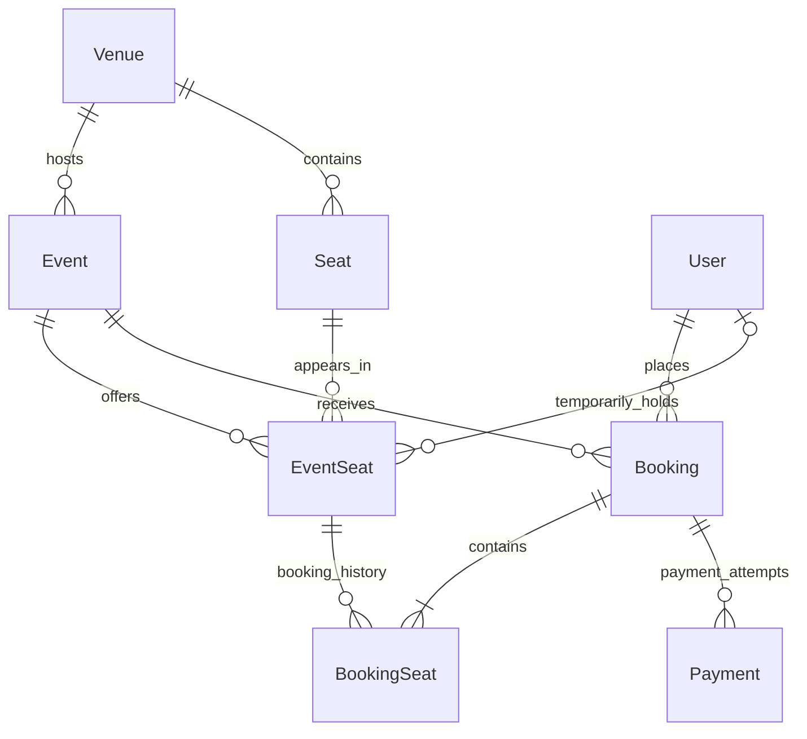

# Data Model

## Diagram

## Tables

### Venue

| Column | Type | Notes |
| --- | --- | --- |
| Id | Guid | PK. |
| Name | string | Venue name. |
| Location | string | Venue address or location. |
| Capacity | int | Seat capacity. |

### Event

| Column | Type | Notes |
| --- | --- | --- |
| Id | Guid | PK. |
| VenueId | Guid | Required FK to Venue.Id. |
| StartDate | DateTimeOffset | Event start time, stored in UTC. |
| Name | string | Event name. |

### Seat

| Column | Type | Notes |
| --- | --- | --- |
| Id | Guid | PK identifying the physical seat. |
| VenueId | Guid | Required FK to Venue.Id. |
| Label | string | Seat label, for example A5; unique within its venue. |

### User

| Column | Type | Notes |
| --- | --- | --- |
| Id | Guid | PK. |
| Email | string | Email address. |
| Name | string | User's display name. |
| Role | enum | Customer, Organizer, or Admin for the MVP. |

### Booking

| Column | Type | Notes |
| --- | --- | --- |
| Id | Guid | PK. |
| EventId | Guid | Required FK to Event.Id; one booking is for one event. |
| UserId | Guid | Required FK to User.Id; the customer placing the booking. |
| Status | enum | Pending, Confirmed, Expired, or Cancelled. |
| CreatedAt | DateTimeOffset | Booking creation time, stored in UTC. |

### BookingSeat

| Column | Type | Notes |
| --- | --- | --- |
| Id | Guid | PK. |
| BookingId | Guid | Required FK to Booking.Id. |
| EventSeatId | Guid | Required FK to EventSeat.Id; unique within the booking. |
| Price | decimal | Price captured at booking time. |

### Payment

| Column | Type | Notes |
| --- | --- | --- |
| Id | Guid | PK. |
| BookingId | Guid | Required FK to Booking.Id. |
| ProviderName | string | Payment service provider, for example Stripe. |
| Amount | decimal | Amount for this payment attempt. |
| Status | enum | Pending, Succeeded, or Failed. |

### EventSeat

| Column | Type | Notes |
| --- | --- | --- |
| Id | Guid | PK identifying one seat offering at one event. |
| EventId | Guid | Required FK to Event.Id. |
| SeatId | Guid | Required FK to Seat.Id; (EventId, SeatId) is unique. |
| Status | enum | Available, Held, or Booked. |
| HoldExpiresAt | DateTimeOffset? | UTC expiry time; required while Held. |
| HeldByUserId | Guid? | Optional FK to User.Id; required while Held. |
| RowVersion | byte[] | SQL Server rowversion, generated and updated automatically by the database. |

## Design decisions

1. **Where does seat status live?** On EventSeat. Seat describes the physical A5 at a venue; EventSeat connects it to one event. Sarah can book A5 for a tech meetup while Ahmed books the same physical seat for a different music event.

2. **How does one booking connect to many seats?** BookingSeat connects Booking to EventSeat. A booking for four seats has four BookingSeat rows.

3. **Seat hold columns:** HoldExpiresAt stores the expiry time, and HeldByUserId identifies the customer holding the seat. The hold lasts 10 minutes by default (configurable). If payment is not completed before expiry, the seats are released.

4. **Statuses:** Booking uses Pending, Confirmed, Expired, and Cancelled. EventSeat uses Available, Held, and Booked. Successful payment confirms the booking; an unpaid expired hold expires it.

5. **Concurrency column:** RowVersion belongs to EventSeat. Sarah and Ahmed read the same row with version V1. Sarah saves first, and SQL Server updates the version to V2. Ahmed's update still uses V1, so EF Core rejects it with DbUpdateConcurrencyException. The booking flow should return HTTP 409 for this conflict. SQL Server updates rowversion automatically; its C# type is byte[].

6. **Money type:** decimal. double uses binary floating point and cannot represent 0.1 exactly, so 0.1 + 0.2 can produce 0.30000000000000004. decimal uses a base-10 scale and represents these values exactly within its precision: 0.1m + 0.2m equals 0.3m.

7. **IDs:** Guid values can be generated in code before saving and are harder to enumerate than consecutive integers. Booking ownership checks are still required. On .NET 9+, Guid.CreateVersion7() creates timestamp-based IDs; their effect on index performance depends on the database's ordering.
