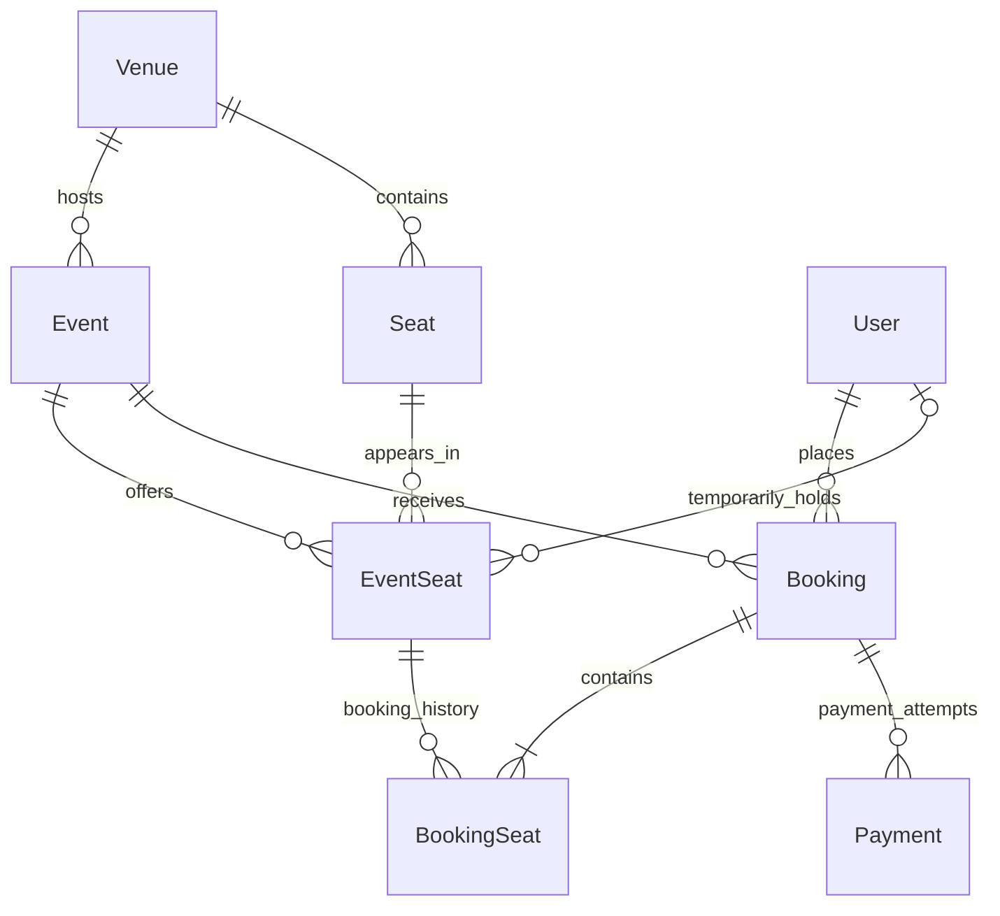

# Data Model

## Scope and conventions

This is the planned MVP database model for [requirements.md](requirements.md). It documents the tables and rules; the current API still stores events in memory.

- Use PascalCase for table and column names and Guid for entity IDs.
- For a one-to-many relationship, put the foreign key on the many side. For example, Event.VenueId allows one Venue to host many Events.
- Store dates in UTC using DateTimeOffset. Hold expiry is a date/time, not a SQL Server timestamp/rowversion value.
- PK means primary key; FK means foreign key. Nullable columns use a question mark.
- Store money as decimal and record its currency explicitly.

## Diagram

The first eight relationships cover the required core model. The final two show the additional FKs Booking.EventId and EventSeat.HeldByUserId, so the diagram includes every FK in the tables.

## Tables

### Venue

| Column | Type | Notes |
| --- | --- | --- |
| Id | Guid | PK. |
| Name | string | Venue name. |
| Location | string | Venue address or location. |
| Capacity | int | Maximum seat capacity; must not be negative. |

Event.VenueId represents the events hosted here. Venue has no EventId column.

### Event

| Column | Type | Notes |
| --- | --- | --- |
| Id | Guid | PK. |
| VenueId | Guid | Required FK to Venue.Id. |
| StartDate | DateTimeOffset | Event start time, stored in UTC. |
| Name | string | Event name. |
| Currency | string | Currency code used for this event's seat prices. |

Upcoming events have StartDate strictly later than the current UTC time.

### Seat

| Column | Type | Notes |
| --- | --- | --- |
| Id | Guid | PK identifying the physical seat. |
| VenueId | Guid | Required FK to Venue.Id. |
| Label | string | Seat label within the venue, for example A5. |

- Make (VenueId, Label) unique. A5 can exist at different venues, but only once within one venue.
- Seat contains no EventId, price, or booking status. It describes the physical seat at the venue.
- EventSeat connects this physical seat to each event at which it is offered.

### User

| Column | Type | Notes |
| --- | --- | --- |
| Id | Guid | PK. |
| Email | string | Unique email address; normalize consistently before enforcing uniqueness. |
| Name | string | User's display name. |
| Role | enum | Customer, Organizer, or Admin for the MVP. |

Booking.UserId identifies the customer who booked. EventSeat.HeldByUserId identifies the customer temporarily holding a seat.

### Booking

| Column | Type | Notes |
| --- | --- | --- |
| Id | Guid | PK. |
| EventId | Guid | Required FK to Event.Id; one booking is for one event. |
| UserId | Guid | Required FK to User.Id; the customer placing the booking. |
| Status | enum | Pending, Confirmed, Expired, or Cancelled. |
| CreatedAt | DateTimeOffset | Booking creation time, stored in UTC. |
| Currency | string | Currency captured from Event.Currency when the booking is created. |

- Booking has no SeatId: its seats are represented by BookingSeat rows.
- Booking has no VenueId: the venue is available through Event.VenueId.
- Booking has no payment FK: each Payment points to its Booking, allowing failed attempts followed by another attempt.
- A booking contains at least one BookingSeat, and its total is the sum of those rows' captured prices.

### BookingSeat

| Column | Type | Notes |
| --- | --- | --- |
| Id | Guid | PK. |
| BookingId | Guid | Required FK to Booking.Id. |
| EventSeatId | Guid | Required FK to EventSeat.Id. |
| Price | decimal | Price captured at booking time, in Booking.Currency. |

- Make (BookingId, EventSeatId) unique so a seat cannot appear twice in one booking.
- Every referenced EventSeat.EventId must match Booking.EventId.
- Keep these rows for expired and cancelled bookings to preserve history and the original price.
- Do not make EventSeatId globally unique in this table: an expired booking and a later booking can reference the same offering. Current allocation is protected through EventSeat's status, RowVersion, and transactional booking rules.

### Payment

| Column | Type | Notes |
| --- | --- | --- |
| Id | Guid | PK. |
| BookingId | Guid | Required FK to Booking.Id. |
| ProviderName | string | Payment service provider, for example Stripe. Mastercard is a card network, not this provider field. |
| ProviderReference | string? | Provider's reference for this payment attempt, when available. |
| Amount | decimal | Amount for this attempt; must match the booking total when paying the entire booking. |
| Currency | string | Must match Booking.Currency. |
| Status | enum | Pending, Succeeded, or Failed. |
| CreatedAt | DateTimeOffset | Payment-attempt creation time, stored in UTC. |

One booking can have multiple attempts, such as Failed followed by Succeeded. A retry or duplicate success notification must not charge or confirm the same booking twice.

### EventSeat

| Column | Type | Notes |
| --- | --- | --- |
| Id | Guid | PK identifying one seat offering at one event. |
| EventId | Guid | Required FK to Event.Id. |
| SeatId | Guid | Required FK to Seat.Id; identifies the physical seat. |
| Price | decimal | Current price in Event.Currency; must not be negative. |
| Status | enum | Available, Held, or Booked. |
| HoldExpiresAt | DateTimeOffset? | UTC expiry time; required while Held. |
| HeldByUserId | Guid? | Optional FK to User.Id; required while Held. |
| RowVersion | byte[] | SQL Server rowversion, generated and updated automatically by the database. Configure as an EF Core concurrency token. |

- Make (EventId, SeatId) unique: a physical seat is offered once per event.
- Seat.VenueId must equal Event.VenueId for this offering.
- Available and Booked rows have no active hold: HoldExpiresAt and HeldByUserId are null. Held rows have both values.
- A held seat must belong to one Pending booking through BookingSeat, with Booking.UserId matching HeldByUserId.
- A booked seat belongs to one Confirmed booking through BookingSeat. Historical entries in expired or cancelled bookings do not represent a current allocation.

## Design decisions

### 1. Seat and EventSeat describe different things

Seat is the physical A5 at a venue. EventSeat is A5 offered at a particular event, with its own price, status, and concurrency token. EventSeat resolves the many-to-many relationship between Event and Seat, not between Venue and Event.

Sarah can book A5 for a tech meetup while Ahmed books that same physical A5 for a different music event. Those are different EventSeat rows. For the same event, they must compete for the same row.

### 2. One booking can contain many seats

BookingSeat connects Booking to EventSeat. A four-seat booking has four BookingSeat rows. Its stored prices preserve what the customer agreed to pay even if EventSeat.Price changes later.

### 3. Holds and status transitions

- Booking starts as Pending while payment is awaited. Successful payment before expiry changes it to Confirmed; an unpaid expired hold changes it to Expired. Customer cancellation changes an eligible booking to Cancelled.
- Seat status lives on EventSeat: Available -> Held -> Booked. Expiry or cancellation of a pending booking releases Held seats back to Available.
- Set HoldExpiresAt to one captured UTC time plus the configured duration, initially 10 minutes. All seats in the group receive the same expiry and HeldByUserId.
- Held seats cannot be claimed by another booking. Payment confirmation must verify that the booking is still Pending, every requested seat is still Held for its customer, and every hold is unexpired.
- Successful confirmation marks the entire group Booked and clears the hold columns. Expiry marks the pending booking Expired and releases its entire held group together, retaining BookingSeat history.
- Cancellation and refunds after a booking is already Confirmed need a separate business policy; the statuses alone do not define that policy.

### 4. RowVersion detects conflicting updates

Sarah and Ahmed both read the same Available EventSeat with the same RowVersion, V1. Sarah saves a hold first, and SQL Server changes the stored version to V2. Ahmed then tries to save using the V1 he originally read. EF Core includes that original version in the update condition, so Ahmed's update affects no rows and SaveChanges throws DbUpdateConcurrencyException.

The database updates rowversion automatically; it is an eight-byte binary token represented as byte[] in C#, not an int or a date. Configure it with [Timestamp] or .IsRowVersion() so EF Core uses it for concurrency checks. The booking flow should translate a conflicting seat claim into HTTP 409 Conflict. This describes planned behavior; the current generic exception handler does not yet implement that mapping. [EF Core concurrency documentation](https://learn.microsoft.com/en-us/ef/core/saving/concurrency)

RowVersion must be combined with availability checks and a transaction. Claim all EventSeat rows and create the Booking and BookingSeat rows atomically. If any seat is unavailable or any update conflicts, roll back the entire group; do not silently retry the same booking against a seat now held by someone else.

### 5. Money uses decimal

double represents numbers in binary floating point, so values such as 0.1 cannot be represented exactly. For example, 0.1 + 0.2 can produce 0.30000000000000004. decimal uses a base-10 scale and can represent those finite decimal values exactly within its supported precision: 0.1m + 0.2m equals 0.3m. This makes decimal appropriate for monetary amounts. [C# numeric-type documentation](https://learn.microsoft.com/en-us/dotnet/csharp/language-reference/builtin-types/floating-point-numeric-types)

Formatting an amount as 4.00 is separate from storing it accurately. Configure SQL decimal precision and scale, and define rounding rules for the supported currencies; decimal has finite precision and division can still require rounding.

### 6. IDs use Guid

- Generate IDs in application code before saving, so related new objects can reference them without first requesting an ID from the database.
- GUIDs reduce easy enumeration compared with consecutive integers. They do not replace authorization: every private booking lookup must still verify that the authenticated user owns the booking or has the required permission. An ID is not an access token. [OWASP IDOR guidance](https://cheatsheetseries.owasp.org/cheatsheets/Insecure_Direct_Object_Reference_Prevention_Cheat_Sheet.html)
- On .NET 9+, use Guid.CreateVersion7() for new application-generated IDs. Version 7 contains a timestamp and random components, giving IDs a time-oriented structure instead of the fully random placement of Version 4. [Guid.CreateVersion7 documentation](https://learn.microsoft.com/en-us/dotnet/api/system.guid.createversion7?view=net-10.0)
- Random insertion into a clustered index can increase page splits and fragmentation. A time-oriented ID can help locality with compatible ordering, but Version 7 does not guarantee faster or sequential inserts for every database. SQL Server uniqueidentifier ordering differs from normal Guid comparison; verify the actual index strategy rather than assuming UUIDv7 sorts chronologically there. [SQL Server GUID comparison documentation](https://learn.microsoft.com/en-us/sql/connect/ado-net/sql/compare-guid-uniqueidentifier-values?view=sql-server-ver17)

## Required constraints and remaining work

- Enforce PKs, FKs, and the unique combinations (VenueId, Label), (EventId, SeatId), and (BookingId, EventSeatId) in the database.
- Enforce event/venue consistency, one event per booking, valid hold ownership, and non-negative seat prices inside the booking transaction and through database constraints where possible.
- Recheck status and expiry when confirming or releasing a hold. Mark an expired group Expired before making its seats claimable again, as part of the same transaction.
- Payment-provider calls are external to the database transaction. Idempotency, late payment notifications, and refund handling need an explicit integration flow before real payments are enabled.
- Implement the schema, migrations, EF Core concurrency configuration, and HTTP 409 mapping in later code work. They are documented here, not implemented by this document change.
